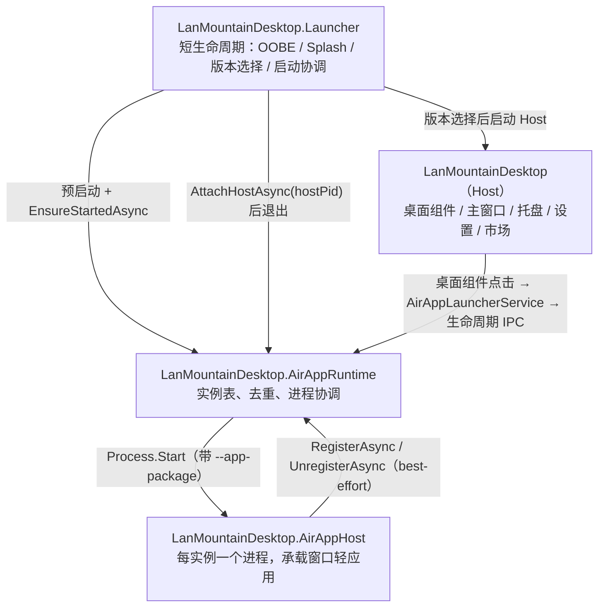

# 整体架构

本文档是**仓库级架构的唯一权威来源**（登记见 [DOC_SOURCES](../ai/DOC_SOURCES.md)）。它回答三件事：有哪些进程、它们怎么协作、边界在哪里。

- 读者指南：[AirApp 开发指南](../01-AirApp开发/README.md)（怎么写轻应用）
- 运行时与窗口链路：[AirApp 运行时](../02-AirApp运行时/README.md)（本文与它分工不重叠：本文讲结构与取舍，它讲窗口形态怎么用）
- 迁移：[AirApp SDK V1 迁移指南](../AIRAPP_SDK_V1_MIGRATION.md)

> **维护约定**：本文所有"现状"陈述都对应仓库源码。写作时按 [CODEBASE_MAP](../ai/CODEBASE_MAP.md) 定位入口，
> 并在文末「如何复核本文」里跑一遍符号核对。**不要把"计划中"写成"当前"**——
> 这份文档历史上就因为把已实现的能力写成"未接入"（以及反过来）而被误引用过。

最后核对：2026-11-14。

---

## 1. 系统定位与仓库边界

阑山桌面的扩展形态**只有一种**：AirApp（轻应用）。桌面组件与窗口轻应用都由同一套 SDK 提供，不存在第二套插件 API。旧体系 `LanMountainDesktop.PluginSdk` / `plugin.json` / apiVersion 4.x–6.x 在宿主里**没有任何代码路径**会接受它们。

| 仓库 | 职责 | 与本文的关系 |
|---|---|---|
| `LanMountainDesktop`（本仓） | 宿主、宿主侧 AirApp 运行时、AirApp SDK、共享契约、Core | 本文全部内容的事实来源 |
| `LanAirApp`（兄弟仓） | 市场源：`registry/official-airapps.json` → CI 生成 `airappmarket/index.json` | 宿主只消费 `index.json`，不生产 |
| `LanMountainDesktop.SamplePlugin` 等 | 官方 / 社区示例轻应用，各自独立发版 | 作为外部包被加载，不参与宿主构建 |

宿主启动时只读兄弟仓的 `airappmarket/index.json`（工作区调试时按相对路径 `..\LanAirApp\...` 解析，见 `AirApps/AirAppMarketIndexService.cs` 的本地优先分支）。

---

## 2. 进程拓扑



| 进程 | 职责 | 关键实现 |
|---|---|---|
| `LanMountainDesktop` | 同进程内加载 AirApp 程序集、渲染桌面组件与设置页、组装打开请求 | `AirApps/AirAppRuntimeService.cs`、`AirApps/AirAppLoader.cs` |
| `LanMountainDesktop.Launcher` | OOBE、Splash、部署版本选择、预启动 Runtime、交接 Host PID 后退出 | `desktop/LanMountainDesktop.Launcher/`、`Shell/AirAppRuntimeBridge.cs` |
| `LanMountainDesktop.AirAppRuntime` | 生命周期与控制 IPC、实例去重、启动/激活/关闭 AirAppHost | `airapp/LanMountainDesktop.AirAppRuntime/` |
| `LanMountainDesktop.AirAppHost` | 内置三窗口 + 按 `--app-package` 加载第三方窗口，把内容嵌进自己的窗口外壳 | `airapp/LanMountainDesktop.AirAppHost/` |

两个容易误解的点：

1. **AirAppHost 不是一份独立实现**。它的 csproj 直接 `ProjectReference` 宿主工程（`AdditionalProperties="SkipAirAppHostBuild=true"`），复用同一份 `AirAppLoader`、组件系统与本地化资源。所以"进程隔离"是**运行期**隔离，不是**代码**隔离——两边跑的是同一套逻辑。
2. **Launcher 不承载任何桌面组件或窗口**。它在完成 Host PID 交接后应当退出，不保留透明/后台窗口。

---

## 3. 启动流程

### 3.1 生产启动

```
Launcher.exe
  → 首次启动？显示 OOBE
  → Splash
  → 扫描 app-* 部署目录，选最佳版本
  → 预启动 AirAppRuntime（EnsureStartedAsync，等 IPC 就绪）
  → 启动 app-{version}-{index}/LanMountainDesktop.exe
  → Host 初始化（见 3.3）
  → Launcher 拿到存活 Host PID，AttachHostAsync(hostPid)
  → 写启动结果，关闭 Splash，Launcher 退出
  → Host 与 AirAppRuntime 独立运行
```

### 3.2 部署目录约定

单一权威是 `core/LanMountainDesktop.Core/Deployment/DeploymentLayout.cs`，安装器与启动器都必须引用它，禁止各自硬编码：

| 常量 | 值 | 含义 |
|---|---|---|
| `DeploymentDirectoryPrefix` | `app-` | 部署目录前缀，完整形式 `app-{version}-{index}` |
| `CurrentMarkerFileName` | `.current` | 当前活动部署 |
| `PartialMarkerFileName` | `.partial` | 复制中 / 失败的部署 |
| `DestroyMarkerFileName` | `.destroy` | 待清理部署 |
| `LauncherStateDirectoryName` | `.Launcher` | 启动器状态目录 |

选择规则：`.current` 优先，其次版本号最高，跳过带 `.partial` / `.destroy` 的。

### 3.3 Host 启动阶段

`App.axaml.cs` 通过 `ReportStartupProgress` 上报，Launcher 的截图与成功判定都依赖这些阶段：

| 阶段 | 进度 | 含义 |
|---|---|---|
| `Initializing` | 10 | 应用初始化 |
| `LoadingSettings` | 20 | 读设置 |
| `LoadingAirApps` | 30 → 35 | 扫描并加载轻应用（后台线程） |
| `InitializingUI` | 60 | 界面初始化 |
| `TrayReady` | 75 | 托盘就绪 |
| `ShellInitialized` / `DesktopVisible` / `Ready` | — | 外壳就绪 / 桌面可见 / 可交互 |

**轻应用加载不阻塞桌面可见**：`InitializeAirAppRuntime()` 把 `new AirAppRuntimeService(...)` + `LoadInstalledAirApps()` 整体放进 `Task.Run`，完成后 `Dispatcher.UIThread.Post` 换到 UI 线程替换运行时实例。加载失败只降级（记日志、上报"插件加载失败，已跳过"），不会拦截启动。

### 3.4 开发环境

直接启动 `LanMountainDesktop.exe` 时没有 Launcher，跳过 OOBE 与版本管理。首次点击窗口类轻应用时由宿主按需拉起 Runtime：`AirAppLauncherService.SendOpenRequestAsync` 在首次 IPC 失败后调用 `TryStartRuntime()`，再重试 4 次（退避 250ms × 尝试次数）。

---

## 4. 扩展系统：AirApp

### 4.1 两种形态

| 形态 | 运行位置 | 注册方式 | 实例粒度 |
|---|---|---|---|
| 桌面组件 | 宿主进程内，桌面网格 | `AddAirAppComponent<TControl>` | 每个桌面放置位一个控件实例 |
| 窗口轻应用 | 独立 `AirAppHost` 进程 | `AddAirAppWindow<TWindow>` | 每个 `instanceKey` 一个进程 |

```csharp
public sealed class MyAirApp : IAirApp   // 或 AirAppBase
{
    public void Initialize(HostBuilderContext ctx, IServiceCollection services)
    {
        services.AddAirAppComponent<MyWidget>("vendor.app.widget", "我的组件");
        services.AddAirAppWindow<MyWindow>("main", "主窗口");
        services.AddAirAppSettingsSection("vendor.app.settings", "settings.app.title", b => b.AddText(...));
    }

    public Task OnStartedAsync(IAirAppRuntimeContext context) => Task.CompletedTask;
    public Task OnStoppingAsync() => Task.CompletedTask;
}
```

入口类型必须被 `[AirAppEntrance]` 标记，或程序集内**恰好只有一个**实现 `IAirApp` 的具体类型。

### 4.2 包与清单契约

| 项 | 现状 |
|---|---|
| SDK 包 | `LanMountainDesktop.AirAppSdk`，`SdkVersion` / `ApiVersion` 均为 `1.0.1`（`AirAppSdk/AirAppSdkInfo.cs`） |
| 清单文件名 | `airapp.json`，包内**有且仅有一份**（多份或缺失都失败，`AirApps/AirAppPackageReader.cs`） |
| 包格式 | `.laapp`，由 SDK 的 `buildTransitive` targets 用 `ZipDirectory` 打包整个构建输出 |
| API 门禁 | `apiVersion` **主版本号必须等于宿主**，无向下兼容宽限 |
| 必需资产 | 入口程序集旁必须有 `.deps.json`（dev 模式只告警）；`runtimes/` 存在但为空直接拒载 |

清单字段：`id`、`name`、`entranceAssembly` 必填；可选 `description`、`author`、`version`、`apiVersion`、`sharedContracts[]`、`runtime.mode`、`components[]`、`windows[]`、`permissions[]`。

两条会拒载的契约检查：

- **组件清单与代码注册必须同批**：`components[].id` 声明了但代码没 `AddAirAppComponent` → 拒载并指名；代码注册了但清单没声明 → 只告警（`AirAppLoader.ValidateManifestComponentContract`）。理由是前者会让用户看到"面板里有格子、点下去没反应"且全程无报错的坏状态。
- **共享契约不得重复**：`sharedContracts` 里 `id@version` 重复直接失败。

### 4.3 发现与优先级

安装根：`<数据根>/Extensions/AirApps`（`AirAppRuntimeService.AirAppsDirectory`）。

扫描顺序与优先级（`AirAppRuntimeService.DiscoverCandidates`，按 `SourceKind` 降序）：

```
DevAirApp (2)  >  Manifest (1)  >  Package (0)
--dev-airapp / LMD_DEV_AIRAPP     散放的 airapp.json      *.laapp
```

- 递归扫描；`.runtime` 子树（解包暂存区）被显式排除，否则会把解出来的副本再扫一遍。
- 同一个 `id` 只保留优先级最高者。**只有开发期覆盖能静默顶掉已注册项**；其余重复一律记为加载失败并写日志。
- 开发期路径支持 `;` 分隔多个，可指向目录或 `.laapp`；开发期轻应用始终启用，不能用设置页禁用。

### 4.4 加载流水线

`AirAppLoader.LoadCore` 的固定次序：

```
1. 建 Data 目录，校验资产（.deps.json / 空 runtimes/）
2. 建 AirAppLoadContext —— isCollectible:true 的 ALC，带共享程序集白名单
3. LoadFromAssemblyPath 加载入口程序集
4. 反射解析入口类型（[AirAppEntrance] 或唯一 IAirApp 实现）
5. new 出实例 → 建 IAirAppRuntimeContext → 建 ServiceCollection
6. IAirApp.Initialize(HostBuilderContext, IServiceCollection)   ← 唯一注册时机
7. BuildServiceProvider(ValidateOnBuild:true) → SetServices → OnStartedAsync(context)
8. 从容器取全部注册：设置节 / 组件 / 组件编辑器 / 服务导出 / 公共 IPC / IHostedService
9. 启动 IHostedService，组装 LoadedAirApp，交给运行时收集贡献
```

三条硬规则：

- **`Initialize` 是唯一注册时机**。返回后容器即冻结，之后再往 `IServiceCollection` 加东西不会有任何效果。
- **`Initialize` 在启动路径上**，每个包的耗时会串行叠加到"桌面可见"时间上。IO / 网络放 `OnStartedAsync` 或后台服务。
- **共享程序集白名单**（SDK 自身 + 清单声明的共享契约）决定哪些程序集由宿主提供。这就是轻应用工程必须写 `ExcludeAssets="runtime;native"` `PrivateAssets="all"` 的原因——把 SDK 打进 `.laapp` 会出现"同名类型不是同一个类型"的诡异错误。

失败处理有一条专门的人话翻译：`MissingMethodException` / `TypeLoadException` 一类绑定错误会被 `ExplainBindingFailure` 改写成"这个包是用另一版 SDK 编译的，请重建"，因为原始异常只有 IL 级方法名，作者读不懂。

### 4.5 贡献点

一个轻应用能向宿主贡献六类东西，全部从它自己的 `ServiceProvider` 里取（前五类是"声明的扩展点"，最后一行是标准的宿主服务）：

| 贡献 | 注册 API | 宿主落点 |
|---|---|---|
| 设置节 | `AddAirAppSettingsSection(...)` / `<TView>` | 设置窗口，进程内渲染 |
| 桌面组件 | `AddAirAppComponent<TControl>` | 桌面组件注册表 + 运行时注册表 |
| 组件编辑器 | `AddAirAppComponentEditor<TControl>` | 组件编辑器窗口 |
| 服务导出 | `AddAirAppExport<TContract, TImpl>` | `AirAppExportRegistry`，供其他轻应用按 `providerAirAppId` 取 |
| 公共 IPC | `AddAirAppPublicIpc<TContract, TImpl>` | 宿主 IPC 主机对外暴露 |
| 后台服务 | 标准 `IHostedService` | 随加载启动、随卸载停止 |

服务导出的契约类型必须是 SDK 内的类型，或清单声明的共享契约程序集里的类型——否则拒载。

### 4.6 桌面组件链路

组件**不在加载时创建**。加载只产出声明，实例化发生在放置时：

```
LoadCore 收集 AirAppComponentRegistration
  → DesktopComponentRegistryFactory.Create：把声明桥接成 DesktopComponentDefinition
  → DesktopComponentRegistryFactory.CreateRuntimeRegistry：包成 RuntimeRegistration
  → 用户拖到网格 → 按 PlacementId 调 ControlFactory
  → ActivatorUtilities.CreateInstance<TControl>(services, AirAppComponentContext)
```

`AirAppComponentContext` 每个放置位一个，携带：清单、`AirAppDirectory`、`DataDirectory`、服务容器、`Properties`、`ComponentId`、`PlacementId`、`CellSize`、外观快照、作用域设置、以及 `OpenWindowHandler`。

`OpenWindowHandler` 就是形态 B 的入口：它回调 `AirAppLauncherService.OpenThirdPartyAirAppWindow(appId, windowId, packageDir, componentId, placementId)`。

组件 id 冲突策略：宿主内置注册优先，轻应用的同名组件被跳过（`Debug.WriteLine` 记录），不抛异常。

### 4.7 窗口轻应用链路

```
组件点"打开"
  → IAirAppLauncherService.OpenThirdPartyAirAppWindow(...)
  → AirAppOpenRequest { AppId, SourceComponentId, SourcePlacementId, RequesterProcessId,
                        TargetEntryId, AppPackagePath }
  → IPC: LanMountainDesktop.AirAppRuntime.v1 → IAirAppLifecycleService.OpenAsync
  → Runtime 算 instanceKey：
        已存在且进程存活 → ShowWindow + SetForegroundWindow 激活，返回 activated_existing
        否则            → Process.Start AirAppHost，返回 started
  → AirAppHost：AirAppLaunchOptions.Parse(args)
                → AirAppWindowLoader.Load → AirAppManifest.Load → AirAppLoader.LoadFromAssembly
                → 按 --target-entry-id（缺省取唯一窗口 / 清单首个窗口）取 AirAppWindowRegistration
                → ActivatorUtilities 创建 IAirAppWindow
                → 把 window.Content 嵌入 FAAppWindow 外壳，套用 window.Descriptor 的 Size/Chrome
```

**实例键决定去重语义**（`AirAppLauncherService.BuildSingleInstanceKey`）：

| 轻应用 | instanceKey | 效果 |
|---|---|---|
| `world-clock` | `world-clock:clock-suite:global` | 全局单例 |
| `rss-reader` | `rss-reader:global` | 全局单例 |
| 其余（含第三方） | `{appId}:{componentId}:{placementId}` | 每个桌面格子可各开一个窗口 |

**生命周期与同步**：

- 窗口打开后 `RegisterAsync`、关闭后 `UnregisterAsync`，两者都是 **best-effort**（异常吞掉）。Runtime 侧靠"进程是否还活着"回收实例，不依赖注销。
- `IAirAppWindow` 回调顺序：`OnWindowOpeningAsync` → `OnWindowOpened` → `OnWindowClosing`（可 `e.Cancel`）→ `OnWindowClosed`。
- Runtime 不主动退出：`AirAppRuntimeLifetime.ShouldKeepAlive()` 要求 Launcher、Host、requester、所有 AirAppHost 全部消失才退。
- 窗口与组件**内存完全隔离**：两边不能共享对象，只能走 `DataDirectory` 或 IPC。窗口崩溃不影响桌面。

### 4.8 状态语义：改动都在重启后生效

| 操作 | 生效时机 | 实现 |
|---|---|---|
| 安装 / 升级 | 重启 | 下载校验后进 `PendingAirAppUpgradeService` 队列，返回 `RestartRequired: true` |
| 启用 / 禁用 | 重启 | 只写 `DisabledAirAppIds` 快照 + `PendingRestartStateService.SetPending` |
| 卸载 | 重启 | 落 pending deletion，启动时 `ApplyPendingAirAppDeletions` 删除（走文件占用重试） |
| 开发期覆盖 | 立即 | 开发期轻应用始终启用，不受快照约束 |

当前**没有热插拔**，也没有"卸载即释放 ALC"。目录不可写时安装走 `ElevatedAirAppInstallService` 提权。

---

## 5. 共享契约

共享契约是**由市场分发、被多个轻应用引用的程序集**（如 `LanMountainDesktop.SharedContracts.SampleClock`）。委托管理在 `AirApps/AirAppSharedContractManager.cs`：

1. 按市场索引定位 `{id}@{version}`，校验 `assemblyName` 一致
2. 落盘到 `<数据根>/SharedContracts/{id}/{version}/{assembly}`，下完先校验 **大小 + SHA-256** 再改名生效
3. 加载进 **`AssemblyLoadContext.Default`**，并把程序集名加进轻应用的共享白名单

三个必须知道的限制：

- **契约加载进 Default ALC，钉死在进程里**，无法随某个轻应用卸载而释放。这与"每个轻应用一个 collectible ALC"的隔离目标存在结构性张力。
- **同一程序集名进程内只允许一个版本**。两个应用分别依赖同一契约的 1.x 与 2.x 时，后加载者会被明确拒绝。
- 回收是保守的：`PruneUnused` 取"盘上现存包（含被禁用的）的引用"作保留集合；**清单集合为空时一律不删**（视为"发现环节坏了"而非"用户卸载光了"）。禁用不是卸载，所以禁用包引用的契约也保留。

---

## 6. IPC 通信

### 6.1 管道

权威常量：`core/LanMountainDesktop.Core/IpcConstants.cs`。

| 常量 | 值 | 承载 |
|---|---|---|
| `DefaultPipeName` | `LanMountainDesktop.IPC.v1.Server` | 宿主对外公共服务（`IPublicAppInfoService`、`IPublicAirAppCatalogService`、`IPublicShellControlService` 等） |
| `AirAppRuntimePipeName` | `LanMountainDesktop.AirAppRuntime.v1` | `IAirAppLifecycleService` + `IAirAppRuntimeControlService` |
| `ProtocolVersion` | `external-ipc-public-api.v1` | 对外 API 协议版本 |

`AirAppLifecyclePipeName` 仍存在但已 `[Obsolete]`，值等于 `AirAppRuntimePipeName`——不要再引用。

### 6.2 对外契约只能是异步方法

**新增 `[IpcPublic]` 方法必须返回 `Task` / `Task<T>` / `ValueTask`。** 原因是死锁而非风格：`dotnetCampus.Ipc` 为同步方法生成的代理内部用 `Task.Wait()` 等回包，而库在自己的读循环线程上投递通知、也在那条线程上续接 `ConnectAsync` 的延续。调用方一旦在这类线程上同步等，回包就只能由当前线程投递 → 进程静默挂死，不报错、不超时。

例外只有随 `LanMountainDesktop.Core` 1.0.0 发出的两个历史同步方法（`IPublicAppInfoService.GetAppInfo`、`IPublicAirAppCatalogService.GetCatalog`），只能"加异步版本 + 标废弃"两步撤。宿主内部要目录/会话信息时走 `LanMountainDesktopIpcClient.GetCatalogAsync()` / `GetSessionInfoAsync()`。

约束由 `IpcPublicContractArchitectureTests` 机器检查，例外名单只减不增。

### 6.3 公共 IPC 导出

轻应用用 `AddAirAppPublicIpc<TContract, TImplementation>()` 注册后，加载完成时运行时会调 `PublicIpcHostService.RegisterPublicService(contractType, implementation, objectId, airAppId, notifyIds)` 挂到宿主 IPC 主机（`AirAppRuntimeService.CollectContributions`）。

契约类型被强制要求：必须是 interface、必须标 `[IpcPublic]`、必须是 SDK 内类型或清单声明的共享契约类型。

### 6.4 轻应用间通信

`IAirAppMessageBus`：按消息类型订阅，或按 topic（字符串）订阅。仅进程内、仅同宿主。跨进程窗口要交换数据只能走 `DataDirectory` 或自建 IPC。

---

## 7. 组件系统

```
ComponentRegistry.CreateDefault()
  + JsonComponentExtensionProvider（<BaseDirectory>/Extensions/Components 的 JSON 扩展）
  + AirApp 贡献的桌面组件定义
        ↓
DesktopComponentRuntimeRegistry（按 ComponentId 解析工厂与圆角策略）
        ↓
桌面网格按放置位创建控件，DesktopPanelLayoutService 管布局持久化
```

- 组件定义：`DesktopComponentDefinition`（id、显示名、图标、分类、最小格数、缩放模式、放置规则）
- 运行时注册：`DesktopComponentRuntimeRegistration`（控件工厂 + 圆角解析）
- 组件库：`ComponentLibraryService`；拖放与编辑模式由 `DesktopPanelManagerService` 协调
- 与轻应用的交汇点是 `AirApps/AirAppContributions.cs` 的三个 contribution 记录，以及 `Services/DesktopComponentRegistryFactory.cs`

**圆角规范（AI 强制）**：桌面组件根容器必须且仅能使用 `{DynamicResource DesignCornerRadiusComponent}`；内部元素按层级用 `DesignCornerRadiusSm/Md/Lg`；严禁硬编码像素值，也严禁在圆角资源上乘 `scale`。Token 的实际数值在不同主题档位下不同（`Styles/GlassModule.axaml`），**不要在文档或代码里写死数值**，细节见 [视觉规范](../03-组件设计规范/02-视觉规范.md)。

---

## 8. 设置与外观

- 持久化实现在宿主：`Services/Settings/SettingsService.cs`，JSON 落到数据根。轻应用作用域设置单独落在 `airapp-settings.json`（历史名 `plugin-settings.json`，首次加载时改名归位，不合并）。
- SDK 只定义契约（`ISettingsService`、`IAirAppSettingsService`、`AirAppSettingsScope`、`AirAppSettingsPageBase`）与声明式构建器（`AirAppSettingsSectionBuilder`）。
- 设置节由 `SettingsCatalogService.RegisterAirAppSections` 登记，设置窗口进程内渲染——**设置页没有进程隔离**。
- 外观：宿主 `IMaterialColorService` 产出快照，经 `AirAppAppearanceSnapshot` 传给轻应用；轻应用可订阅 `Appearance.Changed`。宿主主题切换会通过 IPC 通知窗口类轻应用。

---

## 9. 数据根与磁盘布局

默认 `%LOCALAPPDATA%\LanMountainDesktop`，可用 `--data-root` 覆盖（`Services/AppDataPathProvider.cs`）。

| 路径 | 内容 |
|---|---|
| `Extensions/AirApps/*.laapp` | 已安装轻应用包 |
| `Extensions/AirApps/.runtime/packages/<name>_<hash>/` | 包解包缓存（扫描时排除） |
| `Extensions/AirApps/.runtime/data/<appId>/` | 包内轻应用的数据目录 |
| `Extensions/Components/` | JSON 组件扩展 |
| `SharedContracts/{id}/{version}/` | 共享契约程序集 |
| `AirAppMarket/` | 市场索引缓存、下载 |
| `airapp-settings.json` | 轻应用作用域设置 |
| `Whiteboards/`、`Wallpapers/`、日志 | 其他业务数据 |

存储占用的分类与扫描以 `Services/DataStorageService.cs` 的 `Categories` 为准。

---

## 10. 安全与信任模型（现状，不是目标）

必须明确写下当前**没有**的东西，避免被当成已有保障：

| 项 | 现状 |
|---|---|
| 沙箱 | **无**。桌面组件在宿主进程内、以宿主权限、在 UI 线程上运行 |
| `permissions[]` | **装饰性**。全仓没有任何代码读取并执行它，声明 `FileSystem.Write` 不产生约束 |
| 包签名 | **无签名验证**。信任建立在"索引由官方 CI 生成"上 |
| 包完整性 | 市场安装时若索引条目带 `sha256` 则校验，**缺失则跳过**；共享契约的大小 + SHA-256 校验是强制的 |
| 路径约束 | 安装目标必须落在允许根内（`PathContainment`）；包内清单唯一性；`.runtime` 排除 |

结论：**加载即完全信任**。轻应用与宿主的信任级别相同。

---

## 11. 已知缺口

| 缺口 | 证据 |
|---|---|
| `runtime.mode` 的 `isolated-background` / `isolated-window` 只做解析校验，**无任何分支消费** | 除清单解析与一个测试断言外全仓无 `RuntimeMode` 使用；写入后不改变加载行为 |
| `AirAppIpcClient` / `AirAppIpcServer` 是**桩** | 抛 `"not yet bound to a dotnetCampus.Ipc transport dispatcher"`；`InProcAirAppIpcTransport` 只在测试里成对连过 |
| 跨进程 IPC 握手**未验证** | `ExternalAirAppLoadProbeTests` 只覆盖"加载 + 清单 + 组件注册"，全文无 IPC 调用；`AirAppProcessStarterRuntimeTests` 只验 `StartInfo` 拼装，没真起一次握手 |
| CI 不跑生态探针 | `code-quality.yml` 的 Test 步骤用 `FILTER='Category!=EcosystemProbe'` 排除，所以"CI 绿"对上一行既不是支持也不是反对证据 |
| 无热插拔 | 安装/升级/启用/卸载全部"重启后生效"（见 4.8） |
| 窗口外壳的语义陷阱 | `AirAppWindowBase` 继承 Avalonia `Window`，但窗口实例从不 `Show()`，只有 `Content` 被嵌入 `FAAppWindow`。在作者侧调 `Show()` / 依赖 `Owner` 行为会与直觉不符 |

被验证到的部分（可作为回归基线）：**加载与清单契约**。外部六份真实仓库的构建产物在本地被加载并校验组件声明；缺同级仓库时按 `LMD_STRICT_AIRAPP_PROBE` 决定红还是 Skip。

---

## 12. 文档分工

| 问题 | 看哪里 |
|---|---|
| 进程怎么协作、边界在哪、哪些没实现 | **本文** |
| 窗口轻应用怎么用、IPC 契约形状 | [AirApp 运行时](../02-AirApp运行时/README.md) |
| 怎么写一个轻应用（发现→加载→启动→停止） | [轻应用生命周期](../01-AirApp开发/02-核心概念/01-轻应用生命周期.md) |
| 组件/设置怎么注册 | [组件系统](../01-AirApp开发/02-核心概念/02-组件系统.md) / [设置系统](../01-AirApp开发/02-核心概念/03-设置系统.md) |
| 从 PluginSdk 迁移 | [AirApp SDK V1 迁移指南](../AIRAPP_SDK_V1_MIGRATION.md) |
| 哪些 `plugin` 字样是冻结的 | [NAMING_AND_FROZEN_IDENTIFIERS](../ai/NAMING_AND_FROZEN_IDENTIFIERS.md) |
| 代码入口在哪 | [CODEBASE_MAP](../ai/CODEBASE_MAP.md) |
| 冲突时信谁 | [DOC_SOURCES](../ai/DOC_SOURCES.md) |

冲突处理：以源码与 csproj 为准，然后回写文档——本文历史上就是先写下过期结论、再被测量推翻的。

---

## 如何复核本文

改完代码或怀疑本文过期时，按下列符号逐一 grep，任何一条对不上就说明本文需要更新：

```
AirAppSdkInfo.SdkVersion            → 版本号（4.2）
AirAppsDirectory                    → 安装根（4.3）
DiscoverCandidates                  → 优先级（4.3）
LoadCore                            → 加载流水线（4.4）
ValidateManifestComponentContract   → 清单/注册一致性（4.2）
BuildSingleInstanceKey              → 实例键（4.7）
ShouldKeepAlive                     → Runtime 存活（4.7）
IpcConstants.DefaultPipeName        → 管道名（6.1）
PublicIpcHostService.RegisterPublicService → 导出挂载（6.3）
AirAppIpcClient                     → 隔离桩状态（11）
```

同时检查本文出现的所有类名是否仍然存在——本文曾引用过 `ComponentInstanceManager`、`DesktopLayoutService`、`ComponentUpdateService` 这三个**从未存在或已删除**的名字。
